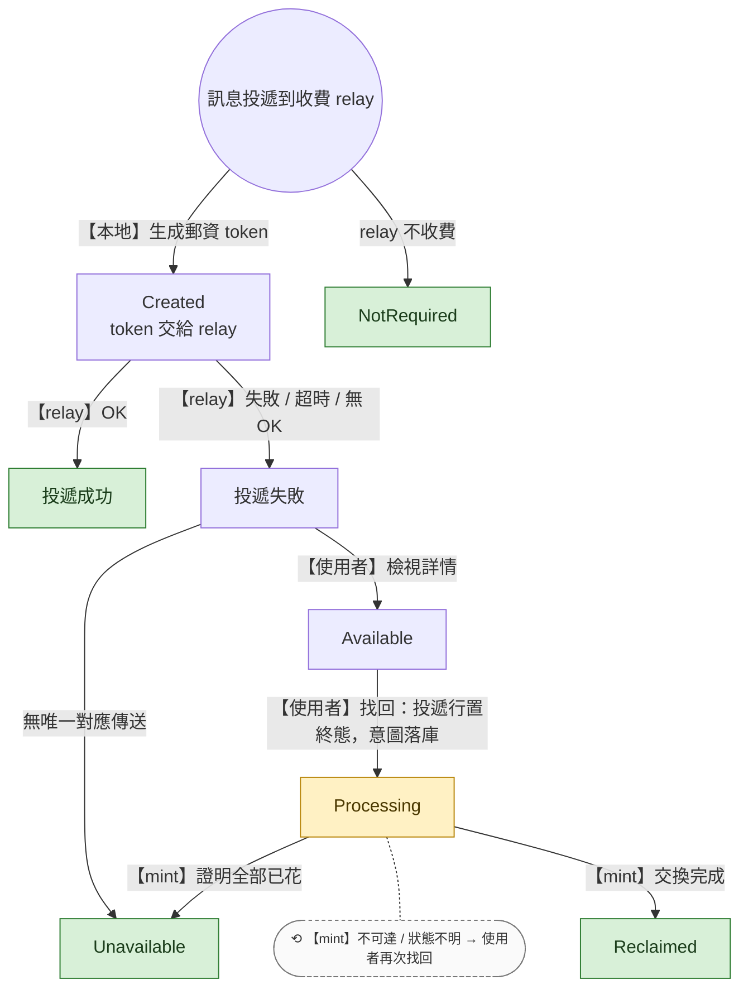

# B4 訊息郵資與找回

[返回目錄](../README.md) · B · 支付與收款

## 狀態圖

GitHub 會直接渲染下方的 Mermaid 程式碼塊；如果顯示異常，請開啟 SVG 圖。

[SVG 圖](diagrams/B4.svg) · [Mermaid 源](diagrams/B4.mmd)

## 狀態表

### 每條投遞（訊息 × relay）

| 編號 | 狀態（程式碼名） | 進入條件 | 資金或資料在哪 | 介面顯示 | 使用者可做的事 | 是否終態 | 程式碼位置 |
|---|---|---|---|---|---|---|---|
| B4-01 | `NotRequired` | relay 不收郵資 | — | — | — | 是（該投遞） | `PC/transport.rs:79-84` |
| B4-02 | `NotStarted` / `Unavailable` | 尚未付或無法付 | 未付出 | — | — | 否 | same as above |
| B4-03 | `Created` | 已生成郵資 token 並隨事件發給 relay | token 交給 relay，錢包流水記 `relay_stamp` 傳送 | — | — | 是（該投遞） | same as above; ledger marker `W/cashu/stamp_reclaim.rs:132-142` |

### 找回（只對失敗的投遞行開放）

| 編號 | 狀態（程式碼名） | 進入條件 | 資金或資料在哪 | 介面顯示 | 使用者可做的事 | 是否終態 | 程式碼位置 |
|---|---|---|---|---|---|---|---|
| B4-04 | 不可找回（無繫結） | 投遞行狀態不在 failed / timeout / no_ack / terminal_failed / retry_exhausted 之列，或曾收到 OK | — | 不顯示入口 | — | — | `A/messaging/stamp_reclaim.rs:5-23` |
| B4-05 | `Available` | 繫結唯一對應一筆 `TokenCreated` 的傳送 saga | token 仍可能未被 relay 兌現 | 顯示找回 | 找回 | 否 | `W/cashu/stamp_reclaim.rs:128-186` |
| B4-06 | `Processing` | 已接受找回意圖（先落庫再動 mint），或 mint 狀態不明、連不上 | 意圖 + 原證明 | 處理中 | 再次找回 | 否 | `W/cashu/stamp_reclaim.rs:187-199`, `:209-252` |
| B4-07 | `Reclaimed` | 交換完成 | 回到錢包 | 已找回 | — | 是 | `W/cashu/stamp_reclaim.rs:203-208`, `:415` |
| B4-08 | `Unavailable` | 證明全部已被花（relay 已兌現），或找不到唯一對應流水 | relay 處 | 不可找回 | — | 是 | `W/cashu/stamp_reclaim.rs:149-158`, `:220-224` |

「同上」指本表上一行。介面顯示列中的 `xxx.yyy` 為本地化文案鍵。
