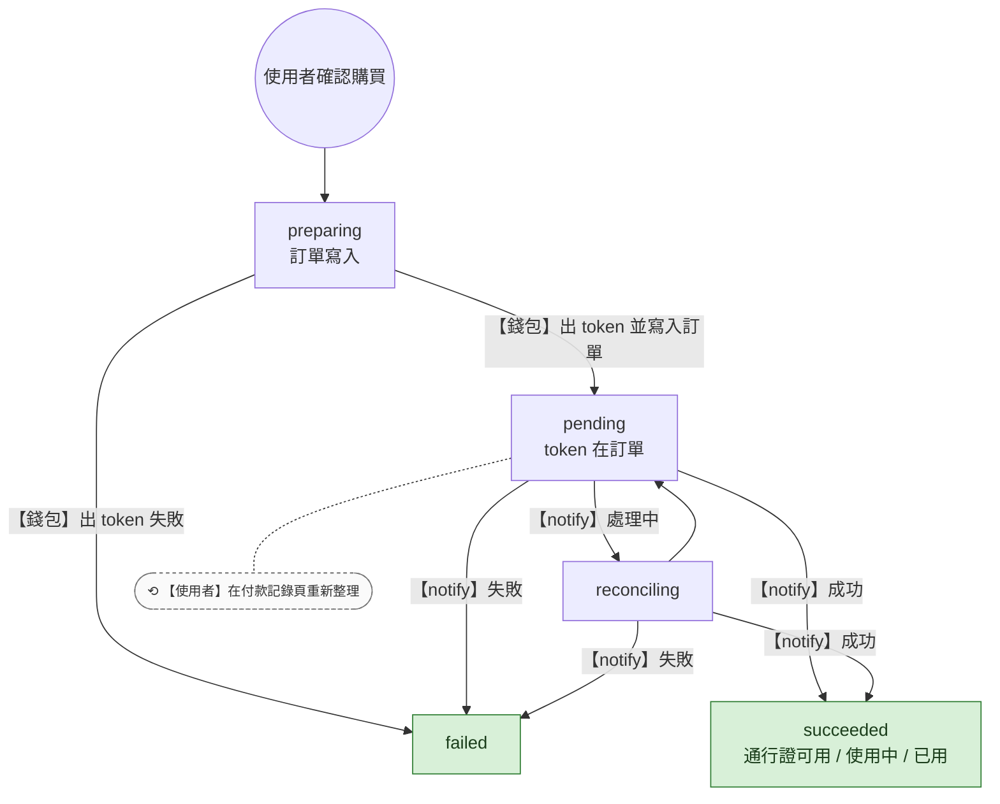

# B5 付費通話票

[返回目錄](../README.md) · B · 支付與收款

## 狀態圖

GitHub 會直接渲染下方的 Mermaid 程式碼塊；如果顯示異常，請開啟 SVG 圖。

[SVG 圖](diagrams/B5.svg) · [Mermaid 源](diagrams/B5.mmd)

## 狀態表

| 編號 | 狀態（程式碼名） | 進入條件 | 資金或資料在哪 | 介面顯示 | 使用者可做的事 | 是否終態 | 程式碼位置 |
|---|---|---|---|---|---|---|---|
| B5-01 | `preparing` → `Preparing` | 使用者確認購買，訂單行寫入 | 尚未出 token；或已出 token 尚未寫入 | 付款中 | 繼續 / 取消 | 否 | `R/app_storage/rtc_tickets.rs:110`; `R/rtc/payments.rs:132` |
| B5-02 | `pending` / `reconciling` → `Confirming` | token 寫入訂單並交給 notify | token 在訂單 | 確認中；確認頁只給 Continue | 繼續輪詢 | 否 | `rtc_tickets.rs:128-141`; `R/rtc/payments.rs:58-59`, `:177-199`, `:329` |
| B5-03 | `succeeded` → `Available` / `UsePending` / `Used` | notify 確認；隨後按使用情況投影 | 通行證 | 可用 / 使用中 / 已用 | 撥打 | 是（支付面） | `rtc_tickets.rs:143-153` |
| B5-04 | `failed` → `Failed` | notify 回失敗，或錢包出 token 失敗 | token 被置空 | 失敗 | — | 是 | `rtc_tickets.rs:118-125`, `:152` |

「同上」指本表上一行。介面顯示列中的 `xxx.yyy` 為本地化文案鍵。
